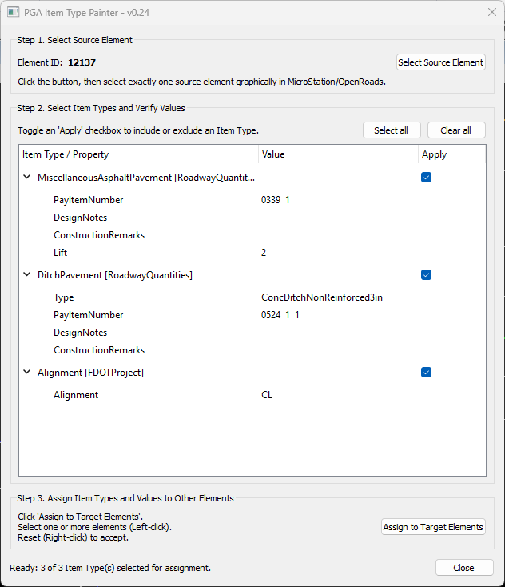
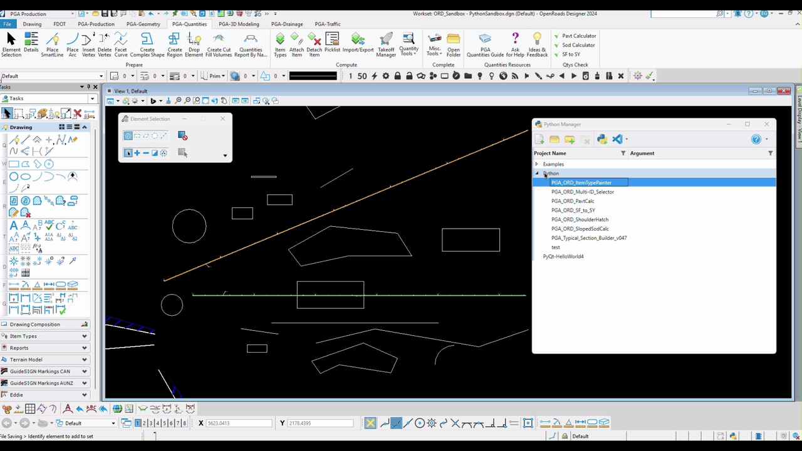

# PythonForMicroStation
Tools for MicroStation and OpenRoads Designer built in Python. Works in version MS 2024, ORD 2026.1, and later. Refer to [Bentley documentation](https://docs.bentley.com/LiveContent/index.html) for more information. 

I welcome any additional tools/scripts so we can make these products better!

## Implementing the Tools
Place the relevant .py files in the directory used by the WorkSpace for Python files. This location is typically controlled by the `MS_PYTHONSCRIPTS` and `MS_PYTHONSEARCHDIRECTORIES` configuration variables.   

Tools can be initiated via the **Python Manager** tool within MicroStation or via key-in: `python load SCRIPTNAME.py`, which allows binding to a function key, button, or other UI element.  

## Custom Tools
### Item Type Painter
This is a UI-based script that relies on `MSPy` and `tkinter` libraries. 
The tool allows the user to select a "source" element from which to inherit Item Types, Item Type properties, and their values. This information is then displayed in the UI. The user can then assign the full extent of all Item Types from the source element to one or more "target" elements. This functionality is non-native to MicroStation, but highly desired when working with Item Types. 

#### v023 Updates (2026-11-19)
1. UX/UI changes
2. Dialog persists after target assignment
3. Item Type properties can be selectively applied to targets

## AI Skill: microstation-python-expert
This skill for Claude, ChatGPT, etc. provides deep instructions for development and handling of Python for MicroStation when vibe-coding. Key highlights include:
1. MSPy API check for updates once per chat
2. Explicit instructions for API usage to reduce hallucinations
3. Proven reference patterns
4. Development standards
5. Code Documentation standards (Google-style)
6. Requirement to provide a complete, versioned script with each iteration
7. Deployment instructions
8. Logging guidance (places a `.log` file for each version in `%TEMP%`)
9. Context (from Bentley's example scripts) for Civil content

Review the SKILL.md and make organization-specific changes as necessary. A `.yaml` file is included under an `agents` subfolder for use with OpenAI.  
